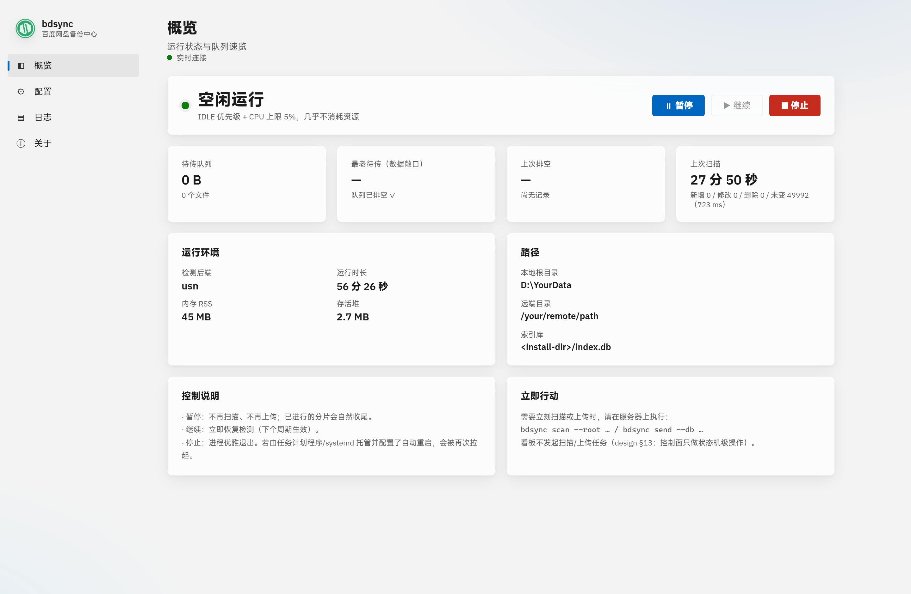
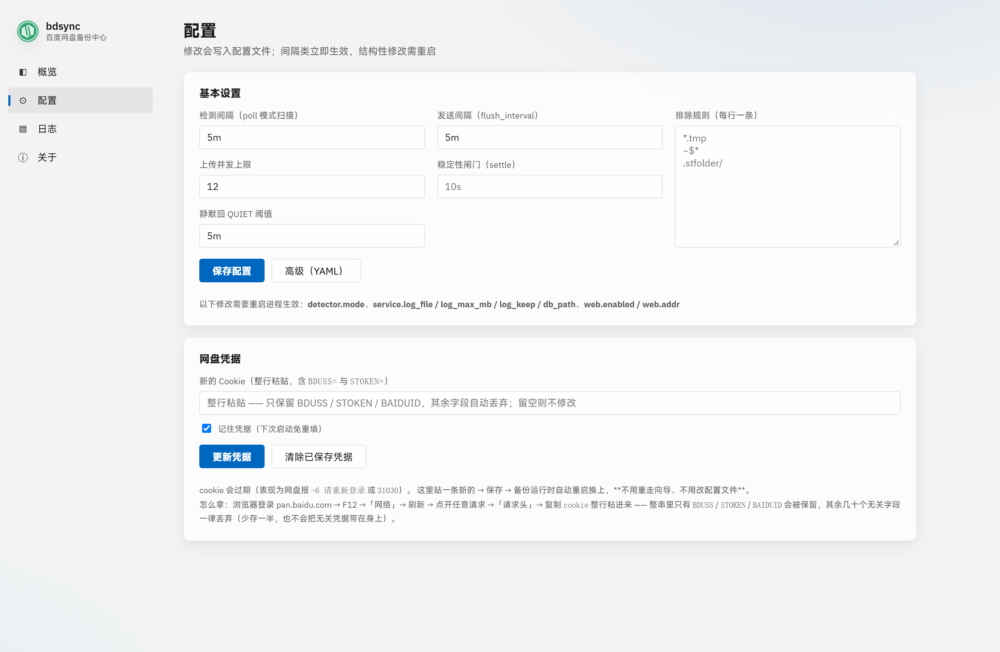
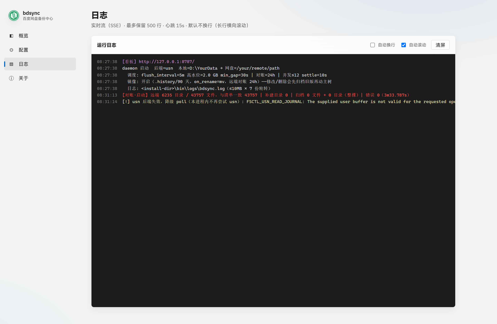
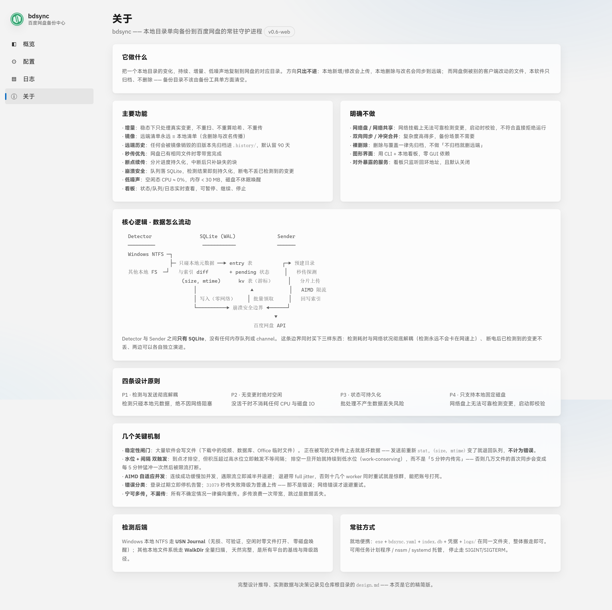

# bdsync

把一个**本地目录**持续备份到**百度网盘**的常驻守护进程。

单向、增量、低噪声 —— 空闲时几乎不耗 CPU，也不唤醒磁盘。



## 是什么

一个 Go 写的单文件程序（`bdsync.exe`），双击即用，没有 GUI 依赖。启动后常驻，
把本地目录的新增 / 修改 / 删除持续同步到网盘的对应目录。

```bash
# 就地便携：整个文件夹一起搬走即可
bdsync.exe
```

首次运行会打开一个本地看板（只监听 `127.0.0.1`），填两项就能开始备份。

## 特点

| | |
|---|---|
| **单向** | 只出不进。本地删了，远端跟着镜像；网盘侧被别处改动的文件只归档、不删除 |
| **增量** | 稳态下只处理真实变更，不重扫、不重算哈希、不重传 |
| **低噪声** | 空闲态 CPU ≈ 0%，内存 < 30 MB，磁盘不休眠唤醒 |
| **可恢复** | 队列落 SQLite，检测结果即刻持久化，断电不丢已检测到的变更 |
| **留历史** | 任何会被镜像销毁的旧版本先归档进 `.history/`，默认留 90 天 |
| **断点续传** | 分片进度持久化，中断后只补缺失的块 |

**明确不做**：网络盘/网络共享（启动即校验，拒绝运行）、双向同步、裸删除、对外暴露的服务。

## 界面

| 概览 | 配置 | 日志 | 关于 |
|---|---|---|---|
|  |  |  |  |

## 架构

```
  Detector                SQLite (WAL)              Sender
  ─────────                ───────────              ──────
  Windows NTFS ─┐
                ├─ 只碰本地元数据 ──▶ entry 表          ┌─▶ 预建目录
  其他本地 FS  ─┘   与索引 diff       + pending 状态     │   秒传探测
                    (size, mtime)      kv 表（游标）     │   分片上传
                        │                  ▲            │   AIMD 限流
                        │ 写入（零网络）    │ 批量领取     │   回写索引
                        └──────────▶ 崩溃安全边界 ◀──────┘
                                                   ▼
                                            百度网盘 API
```

Detector 与 Sender 之间**只有 SQLite**，没有任何内存队列或 channel。这条边界同时买下
三样东西：检测耗时与网络状况彻底解耦、断电后已检测到的变更不丢、两边各自独立演进。

Windows 本地 NTFS 走 **USN Journal**（无损、可验证，空闲时零文件打开）；其他本地文件系统
走 **WalkDir** 全量扫描。

## 构建

```bash
go build -o bdsync.exe ./cmd/bdsync
```

需要 Go 1.27+。无其他依赖，看板（HTML/CSS/JS）内嵌在二进制里。

## 目录

```
cmd/bdsync/     CLI 入口、daemon 主循环、看板后端
internal/
  baidu/        百度网盘 SDK 封装 + cookie 净化
  config/       配置加载与校验
  detector/     变更检测（USN / WalkDir）
  index/        SQLite 索引库
  logx/         日志轮转
  sender/       上传、镜像归档、历史清理
  power/        电源与资源控制
web/            看板前端（go:embed 进二进制）
docs/
  design.md     完整设计文档：推导过程、实测数据、决策记录
  screenshots/  界面截图
```

## 安全与可靠性

| | |
|---|---|
| **看板只在本机** | 只监听回环地址（启动时校验实际绑定地址，非回环拒绝启动）。请求侧三道校验：来源必须回环、`Host` 必须等于监听地址（防 DNS rebinding 绕过同源策略）、写接口必须带同源 `Origin` |
| **凭据不回传** | 所有接口与日志只报"来源/是否存在"，绝不回吐 BDUSS/STOKEN；写盘前统一过白名单净化 |
| **单实例** | 同一索引库只允许一个进程（锁文件 `<db_path>.lock`，锁随进程退出由内核释放，崩溃残留不会挡住下次启动） |
| **不静默失败** | 连续失败达上限的文件不再自动重试，但会出现在 `status`、心跳日志与看板的阻塞计数里 —— 没有"悄悄不同步" |
| **归档优先于覆盖** | 任何会被镜像销毁的旧版本先归档；归档失败绝不用新内容覆盖 |

> 脚本调用看板写接口（`/api/control`、`/api/config`、`/api/credentials`）时，需带请求头
> `X-Bdsync-Local: 1`。浏览器页面本身就是同源的，无需额外处理。

本轮加固的完整清单、设计理由与已知未修项见
[docs/design.md](docs/design.md) 附录 C。

## 部署

就地便携 —— `bdsync.exe` + `bdsync.yaml` + `index.db` + 凭据 + `logs/` 放同一文件夹。

常驻用任务计划程序 / nssm / systemd 均可，停止走 SIGINT/SIGTERM。配置样例见
`internal/config/bdsync.example.yaml`。

凭据（BDUSS / STOKEN）不进配置文件，来源优先级：环境变量 > 同目录 `credentials.dat` > 看板录入。
所有入口都会经过 `SanitizeCookie` 白名单净化，只保留 `BDUSS` / `STOKEN` / `BAIDUID`。

## 文档

[docs/design.md](docs/design.md) —— 完整设计推导、实测数据、决策记录，
以及一份运维答疑（并发度、首跑序列、休眠恢复、队列持久化、静默判活）。
